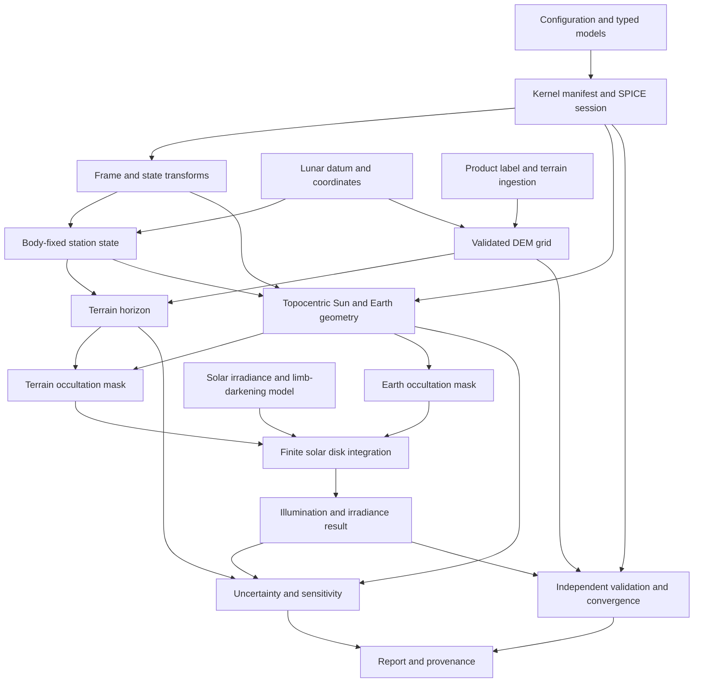

# SELENE-PRIME — Proposed Architecture

**Status:** design proposal for Phase 1. No subsystem implementation is implied.

## Design principles

Use layered Python modules with explicit physical metadata at boundaries. Core calculations accept typed values and validated domain objects rather than unlabelled arrays where practical. Adapters handle SPICE and product formats; scientific services depend on narrow protocols so analytical fixtures can test behavior without masquerading as real ephemerides or PDS data. Results carry provenance and uncertainty. No hidden global kernel state and no implicit frame, datum, unit, or time conversion.

## Proposed package map

```text
src/selene_prime/
  errors.py                 # typed domain, data, frame, coverage, lifecycle errors
  models.py                 # epochs, sites, configs, results, provenance records
  kernels/                  # manifest, hashes, provenance, explicit SPICE lifecycle
  frames/                   # named frame transforms and state/vector conventions
  coordinates/               # supported lunar datum and product coordinate adapters
  geometry/                   # generic vectors, rotations, ellipsoid math, disk overlap
  terrain/products/          # PDS label and selected raster/product adapters
  terrain/grid.py            # validated grid metadata and interpolation
  terrain/horizon.py         # adaptive station-relative horizon service
  terrain/cache.py           # keyed cache with error/provenance metadata
  ephemeris/                 # validated Sun/Earth apparent states and geometry
  radiometry/                # disk quadrature, limb darkening, irradiance
  occultation/                # Earth disk, terrain mask, mask composition
  uncertainty/                # propagation, sensitivity, Monte Carlo
  validation/                 # independent references and convergence records
  reporting/                  # schemas, provenance export, report formatting
  cli.py                      # explicit benchmark/inspection commands
tests/ unit/ integration/ regression/ validation/ fixtures/
benchmarks/                    # versioned inputs/configs; no fabricated results
docs/
```

Names are provisional. Stabilize contracts before implementation. Add root `pyproject.toml` and quality configuration in Phase 2.

## Subsystem responsibilities and contracts

| Subsystem | Owns | Interface contract |
|---|---|---|
| Kernel/ephemeris management | Manifest, hashes, provenance, roles, SPICE lifecycle and coverage probes | Explicit context-managed session; queries name target, observer, frame, epoch, correction policy; cleanup errors do not erase active errors. No implicit global session. |
| Reference frames | Frame identifiers and state/vector transforms | Inputs/outputs name frame and epoch; unavailable transform is an error, never identity fallback. |
| Lunar datum/coordinates | Named radii/model, latitude semantics, conversions | Coordinates name datum, latitude type, longitude convention, height semantics. Unknown metadata rejected. |
| PDS/LOLA ingestion | Supported product detection, labels, decoding, integrity and provenance | Adapter emits validated product metadata; array fixtures use a separate explicitly synthetic constructor. |
| DEM grid/interpolation | Grid geometry, coordinate validation, interpolation and NoData policy | Sample returns value/status and defined error/edge behavior; malformed grids fail construction. |
| Terrain horizon | Station geometry, ray sampling, azimuth, convergence, cache | Validated site/grid/datum/frame/config in; horizon profile and error/convergence metadata out. |
| Solar/Earth apparent geometry | Topocentric observer and apparent direction/size | Calls validated ephemeris service with explicit correction and frame; records query provenance. |
| Solar disk integration | Disk quadrature, limb-darkened weights, visibility integral, irradiance scaling | Receives angular geometry and visibility mask; emits fraction and irradiance with passband/model provenance and quadrature error. |
| Earth occultation | Angular disk overlap and stated atmosphere treatment | Emits solar-disk visibility mask/fraction and integration diagnostics independently from terrain. |
| Terrain occultation | Horizon profile to solar-disk visibility | Uses azimuth-dependent horizon and extended solar disk; reports terrain resolution uncertainty. |
| Combined occultation | Joint mask composition | Combines masks pointwise before integration or proves equivalence; does not multiply unrelated fractions. |
| Uncertainty/sensitivity | Propagation and sampling | Separates input/model uncertainty from numerical error; records assumptions, seed, and method. |
| Validation/benchmarking | Independent expected values, tolerances, executed records, refinement studies | Reference provenance and tolerance predeclared; high resolution is not assumed ground truth. |
| Reporting/provenance | Stable schemas and readable summaries | Quantities include units, model/input IDs, limitations, and execution provenance. |

## Dependency graph



Scientific primitives remain independently testable. Product/SPICE adapters do not depend on reporting or application orchestration.

## End-to-end query sequence

1. Validate query/configuration, site metadata, product identity, and kernel manifest.
2. Hash/verify declared files; establish explicit kernel session and record ownership.
3. Validate actual epoch coverage and target-observer/frame state chain.
4. Decode the product from metadata, validate grid/datum/registration, and construct the station in named body-fixed coordinates.
5. Compute terrain horizon and numerical/interpolation diagnostics. The initial implementation supports a spherical reference surface and planetocentric simple-cylindrical grids only; see `docs/PHASE6_HORIZON.md`.
6. Compute observer-relative Sun and Earth apparent geometry with declared corrections. The initial service solves station-relative geometric LT while omitting stellar aberration; see `docs/PHASE6_APPARENT_GEOMETRY.md`.
7. Build separate terrain and Earth solar-disk masks; integrate their joint mask with sourced radiometry. The initial caller-configured quadrature/mask implementation is in `src/selene_prime/radiometry/disk.py`; see its phase record for limits.
8. Propagate configured uncertainty and run requested refinements with the generic utilities in `src/selene_prime/validation/`; report metric differences separately from input uncertainty.
9. Serialize result/provenance; close kernel session and surface cleanup failures without erasing primary failures.

## Concurrency and resource policy

SPICE kernel-pool state is process-global in common usage and must be treated as shared mutable state until the selected interface is verified. Initial safe policy: one explicitly serialized kernel-owning session per process, with process isolation for independent kernel sets if needed. No thread-safety claim until tested. Track kernel ownership; unload only kernels this manager loaded. Nested sessions and externally preloaded kernels require explicit policy. Use context managers, not destructors. Report cleanup failure while preserving an active primary exception.

## Phase 2 decision gates

The Phase 2 foundation now exists in `pyproject.toml`, `src/selene_prime/`, and the root quality workflow. No scientific dependency or physical convention has been selected.

Select supported Python/platforms; PDS product subset (potentially selected PDS3 LOLA raster products, contingent on actual labels); raster abstraction/dependencies; time conversion API; SPICE process/thread policy; lunar datum/frame for each supported product/use case; radiometric passband and coefficient source; independent reference cases; and performance targets. Current repository evidence does not establish these choices.

## Risk register

| ID | Severity | Risk | Why it matters | Mitigation and exit evidence |
|---|---|---|---|---|
| R-01 | Critical | Kernel coverage, target/observer chain, or frame availability is inferred from file presence or broad metadata rather than the actual requested query. | Produces plausible but invalid apparent directions or silently wrong geometry. | Execute requested state/frame queries at each epoch; negative tests for missing coverage; preserve SPICE exceptions and provenance. |
| R-02 | Critical | DEM datum, registration, vertical units, or latitude/frame convention is misread. | Site can be displaced or horizon geometry biased while calculations appear numerically stable. | Require product metadata; reject ambiguity; independently validate named products and reference points. |
| R-03 | High | Terrain horizon sampling skips narrow ridges or curvature is modeled incorrectly. | Overstates illumination and understates shadow duration. | Resolution-aware/adaptive sampling, analytic ridge fixtures, refinement and bounded-error studies; report DEM limitations. |
| R-04 | High | Topocentric apparent geometry uses Moon-center states or inconsistent light-time/aberration policies. | Station parallax and angular geometry become inconsistent. | Explicit observer state, same policy for relevant bodies, independent station-level SPICE reference cases. |
| R-05 | High | Earth and terrain visibility fractions are combined as independent scalars. | Overlapping obscured parts of the solar disk are double-counted or missed. | Compose pointwise disk masks before integration; test joint partial-overlap cases independently. |
| R-06 | High | Solar irradiance or limb-darkening coefficients are unsourced or used outside their passband. | Results may be precise-looking but have unsupported radiometry. | Select sourced passband/model, track uncertainty and provenance, block unconfigured scientific output. |
| R-07 | High | Synthetic fixtures or self-consistency tests are presented as real-data/independent validation. | Misstates scientific evidence and evaluation readiness. | Tag synthetic cases; require external/analytic references; trace each claim to executed record. |
| R-08 | Medium | PDS product formats vary and a parser silently assumes byte order/scaling. | Elevations can be corrupted by orders of magnitude or shifted pixels. | Scope supported formats; parse labels; verify dimensions, encoding, scaling, units, and product checksum against genuine sample products. |
| R-09 | Medium | SPICE global kernel-pool state causes cross-thread/process contamination or unloads caller-owned kernels. | Nondeterministic queries or resource corruption. | Explicit ownership, serialized initial policy, failure injection, and lifecycle integration tests. |
| R-10 | Medium | Numerical convergence is mistaken for total accuracy or tolerances are selected after results. | A converged wrong model can pass. | Predeclare error budgets/tolerances; separately report reference, input, numerical, and model errors. |
| R-11 | Medium | Required scientific data/dependencies are not available in the target environment. | Blocks genuine integration and reproduction. | Document supported platform and user-supplied data path; keep missing-data status pending; do not fabricate fixtures/checksums. |

Severity describes impact on scientific validity/readiness, not probability. R-01 and R-02 block any credible research claim if unresolved for the requested use case.

## Staged implementation plan

1. **Phase 1 — Requirements/design:** baseline scope, subsystem contracts, assumptions, acceptance evidence, traceability, risks, and gates are documented.
2. **Phase 2 — Project foundation:** package/build metadata, typed shared models/errors, logging/provenance schema, test/lint/type/CI setup, installation docs, and reproducibility policy are in place. No scientific dependencies/conventions were selected.
3. **Phase 3 — Independent geometry primitives:** generic validated coordinates, vectors, rotations, and disk overlap are implemented with analytic references. The generic ellipsoid is not a lunar datum; SPICE integration remains later.
4. **Phase 4 — Kernel and frame adapter:** implemented manifest/hash/lifecycle/ownership, guarded actual-query coverage checks, and epoch-specific frame services. Mock failure tests pass; genuine user-supplied/officially obtained kernel integration and independent references remain pending.
5. **Phase 5 — Terrain products and grid:** initial detached PDS3 LOLA GDR cylindrical integer IMG ingestion, scoped label/byte metadata checks, content SHA-256 provenance, memory-mapped access, and regular-grid interpolation are implemented. Tests use synthetic fixtures; genuine product integration, polar/JPEG2000/PDS4 support, datum transformation, and horizon validation remain pending.
6. **Phase 6 — Horizon and apparent positions:** a restricted spherical terrain horizon is implemented with synthetic tests. Station-level geometric LT positions are implemented with analytic mocks; stellar aberration, genuine kernel checks, and independent horizon references remain pending.
7. **Phase 7 — Occultation and radiometry:** finite-disk quadrature and pointwise Earth/terrain masks are implemented. Sourced physical passband values, atmosphere model, and convergence evidence remain pending.
8. **Phase 8 — Uncertainty, convergence, reporting:** generic successive-refinement, local sensitivity, seeded independent-Gaussian Monte Carlo, and JSON-ready record utilities are implemented. No lunar run has supplied inputs/tolerances to generate a scientific report.
9. **Phase 9 — Independent validation and audit:** run complete tests and real-data reference cases; produce convergence/uncertainty reports and red-team audit; fix critical/high findings before describing readiness for the documented research evaluation.

Each phase has its own reviewable code/docs/evidence increment. If a required kernel, terrain product, or external reference is unavailable, dependent evidence remains explicitly pending while independent work proceeds.
